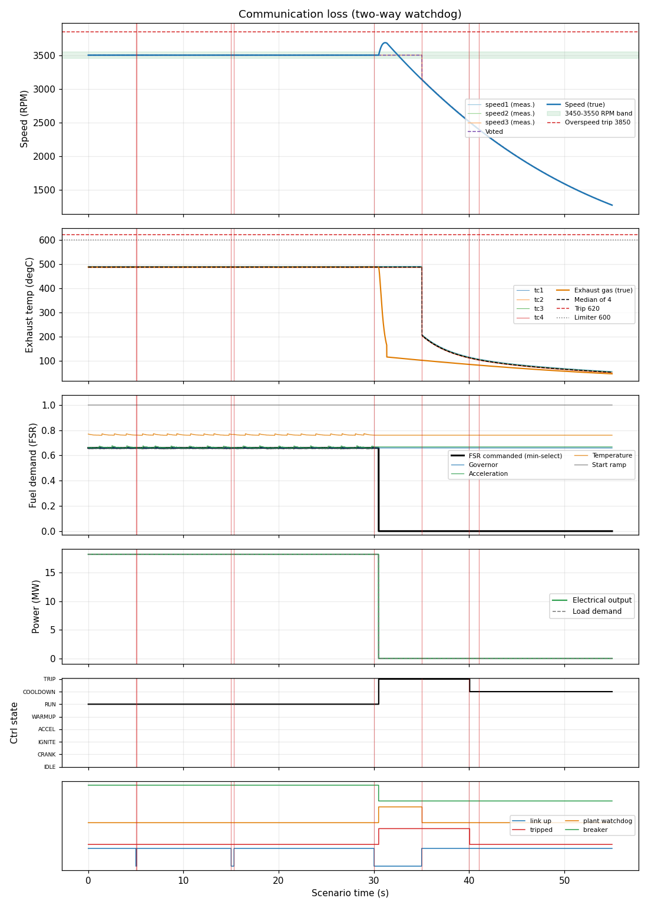

# Communication loss (two-way watchdog)

**Result: PASS**

Unit carries 80 % load. A 80 ms link dropout must pass unnoticed; a 300 ms dropout must raise an alarm only; a 5 s loss must trip the controller after 10 failed polls (500 ms) and make the plant side close the fuel valve and open the breaker by itself. The trip stays latched after the link returns and clears only on an explicit reset, after which the start request is locked out until it is re-issued.

## Criteria

| | Criterion | Measured | Limit |
| --- | --- | --- | --- |
| PASS | An 80 ms dropout raises no alarm | never set | never |
| PASS | A 300 ms dropout raises the comms alarm | set at 15.2 s | between 15 and 20 s |
| PASS | Neither short dropout trips the unit | never set | never |
| PASS | The plant-side watchdog acts within 2 s of the loss | set at 30.5 s | between 30 and 32 s |
| PASS | The controller trips within 2 s of the loss | set at 30.5 s | between 30 and 32 s |
| PASS | Fuel flow is zero 2.5 s after the loss | 0.0 at 32.5 s | 0 to 0.01 |
| PASS | Breaker is open 2.5 s after the loss | 0.0 at 32.5 s | 0 to 0.5 |
| PASS | Speed stays below the overspeed trip level | peak 3685.2 | < 3850 |
| PASS | Trip is still latched 3 s after the link returned (no auto-reset) | 1.0 at 38.0 s | 0.5 to 1.5 |
| PASS | Explicit reset clears the trip | 0.0 at 45.0 s | -0.5 to 0.5 |
| PASS | With the start request still held, the unit does not restart (cool-down only) | 6.0 at 54.0 s | 5.5 to 6.5 |

## Key figures

- Peak speed: 3685 RPM
- Final speed: 1271 RPM
- Peak exhaust gas temperature: 488 degC
- Peak fuel flow: 1.25 kg/s
- Peak electrical output: 18.2 MW
- Tripped: yes (first-out: none)
- Peak exhaust spread: 5 degC

## Negative tests (the rule is removed; the scenario must FAIL)

| Outcome | Rule removed | Criteria that failed | Why this proves the rule |
| --- | --- | --- | --- |
| FAILS AS INTENDED | comms_watchdog, plant_watchdog | plant_wd, ctrl_trip, fuel_closed, breaker_open, stays_latched, no_restart | With both watchdogs removed the unit keeps running on stale commands through a 5 s loss of control. |

## Events

- t = 5.0 s: link (up=False)
- t = 5.1 s: link (up=True)
- t = 15.0 s: link (up=False)
- t = 15.3 s: link (up=True)
- t = 30.0 s: link (up=False)
- t = 35.0 s: link (up=True)
- t = 40.0 s: reset (value=1)
- t = 41.0 s: reset (value=0)

## Plot

## Run record

- scenario file: scenarios/communication_loss.json
- scenario sha256 (first 12): 676f0419b2e5
- run at (UTC): 2026-10-12 16:26:08
- git commit: 5faffda
- seed: 61
- sensor noise: True
- rated electrical power (MW): 22.72
- python: 3.14.4
