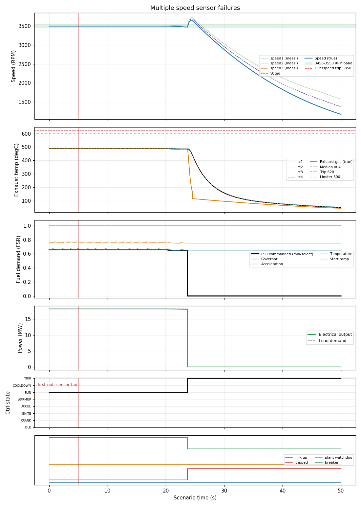

# Multiple speed sensor failures

**Result: PASS**

Unit carries 80 % load. Speed channel 1 sticks at 5 s: one failure must only raise an alarm. At 20 s channel 2 starts to drift: with two channels lost the controller can no longer vote and must trip with a sensor-fault first-out.

## Criteria

| | Criterion | Measured | Limit |
| --- | --- | --- | --- |
| PASS | The stuck channel is flagged within 7 s | set at 6.1 s | between 5 and 12 s |
| PASS | One failed channel does not trip the unit | never set | never |
| PASS | Speed stays above 3450 RPM while only one channel is lost | minimum 3499.8 | > 3450 |
| PASS | The second failure trips the unit within 12 s | set at 23.7 s | between 20 and 32 s |
| PASS | First-out cause is sensor fault | sensor fault | sensor fault |
| PASS | Fuel flow is zero at the end | 0.0 at 49.0 s | 0 to 0.01 |

## Key figures

- Peak speed: 3657 RPM
- Final speed: 1168 RPM
- Peak exhaust gas temperature: 488 degC
- Peak fuel flow: 1.25 kg/s
- Peak electrical output: 18.2 MW
- Tripped: yes (first-out: sensor fault)
- Peak exhaust spread: 5 degC

## Negative tests (the rule is removed; the scenario must FAIL)

| Outcome | Rule removed | Criteria that failed | Why this proves the rule |
| --- | --- | --- | --- |
| FAILS AS INTENDED | sensor_diag | stuck_flagged, trips_on_two, first_out, fuel_closed | Without sensor diagnostics the voter never notices the failures: no alarm and no trip. |

## Events

- t = 5.0 s: speed_fault (ch=0, mode=stuck)
- t = 20.0 s: speed_fault (ch=1, mode=drift, a=15.0, b=400.0)

## Plot

## Run record

- scenario file: scenarios/multiple_sensor_failures.json
- scenario sha256 (first 12): b6544eb491f6
- run at (UTC): 2026-10-12 16:27:38
- git commit: 5faffda
- seed: 51
- sensor noise: True
- rated electrical power (MW): 22.72
- python: 3.14.4
