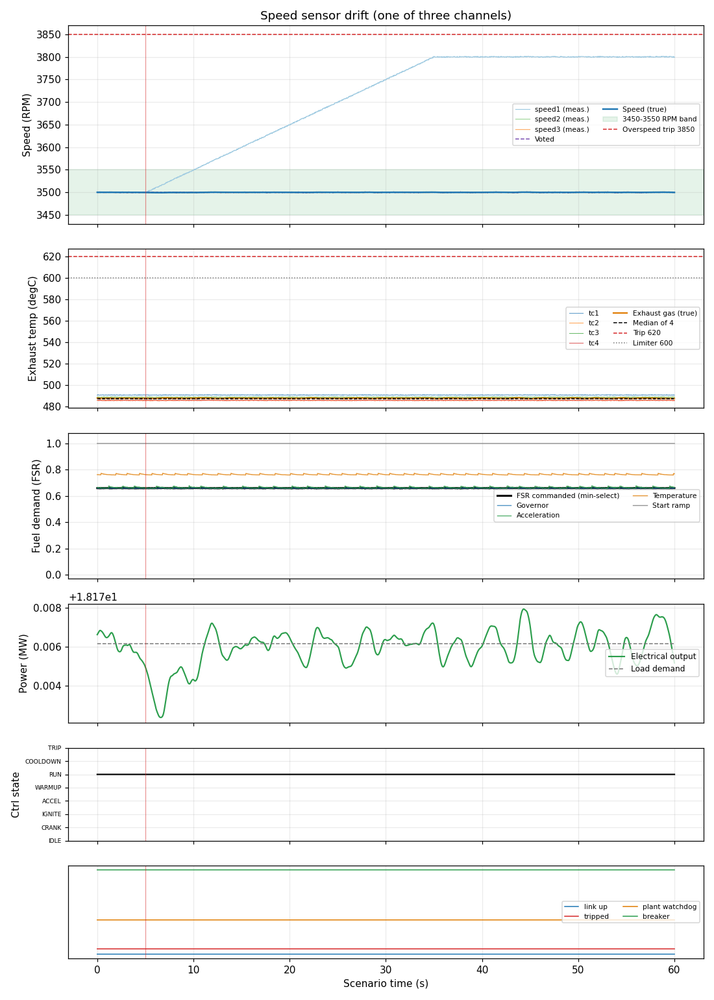

# Speed sensor drift (one of three channels)

**Result: PASS**

Unit carries 80 % load. Speed channel 1 starts to drift upward at 10 RPM/s (up to +300 RPM). With three channels and median voting the controller must keep the real speed on target, flag the bad channel, and not trip.

## Criteria

| | Criterion | Measured | Limit |
| --- | --- | --- | --- |
| PASS | Real speed never falls below 3450 RPM | minimum 3499.3 | > 3450 |
| PASS | Real speed never exceeds 3550 RPM | peak 3500.3 | < 3550 |
| PASS | Channel 1 is flagged bad within 15 s of the drift starting | set at 10.1 s | between 5 and 20 s |
| PASS | Channel 2 is never flagged | never set | never |
| PASS | Controller never trips | never set | never |

## Key figures

- Peak speed: 3500 RPM
- Final speed: 3500 RPM
- Peak exhaust gas temperature: 488 degC
- Peak fuel flow: 1.25 kg/s
- Peak electrical output: 18.2 MW
- Tripped: no
- Peak exhaust spread: 5 degC

## Negative tests (the rule is removed; the scenario must FAIL)

| Outcome | Rule removed | Criteria that failed | Why this proves the rule |
| --- | --- | --- | --- |
| FAILS AS INTENDED | voting | speed_low, flagged | With voting removed the controller believes the drifting channel, cuts fuel, and the real speed sags. |

## Events

- t = 5.0 s: speed_fault (ch=0, mode=drift, a=10.0, b=300.0)

## Plot

## Run record

- scenario file: scenarios/speed_sensor_drift.json
- scenario sha256 (first 12): 8d0ff1babdf4
- run at (UTC): 2026-10-12 16:28:08
- git commit: 5faffda
- seed: 31
- sensor noise: True
- rated electrical power (MW): 22.72
- python: 3.14.4
