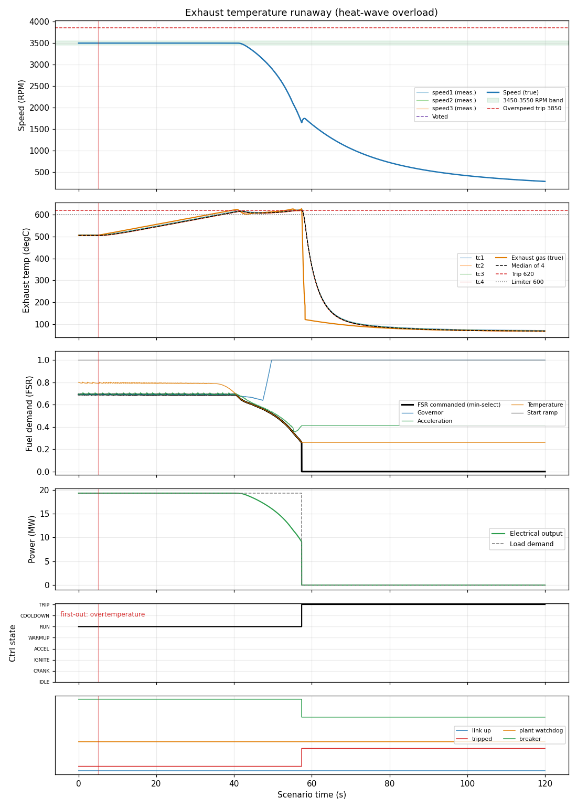

# Exhaust temperature runaway (heat-wave overload)

**Result: PASS**

Unit carries 85 % load. The inlet air temperature then rises by 50 K over 40 s (heat wave / inlet heating) while the load stays fixed, so the exhaust temperature climbs through the 600 degC limiter and the 610 degC alarm. On this isolated, constant-power load the limiter cannot hold the load (cutting fuel lets the speed fall), so protection must take over: alarm first, then a latched over-temperature trip with first-out, fuel closed and breaker opened, before the gas temperature reaches damaging levels.

## Criteria

| | Criterion | Measured | Limit |
| --- | --- | --- | --- |
| PASS | The over-temperature alarm (610 degC) is raised | set at 39.6 s | between 0 and 120 s |
| PASS | The controller trips | set at 57.4 s | between 0 and 120 s |
| PASS | First-out cause is over-temperature | overtemperature | overtemp |
| PASS | True exhaust gas temperature never reaches 700 degC (damage margin) | peak 626.9 | < 700 |
| PASS | Fuel flow is zero at the end of the run | 0.0 at 119.0 s | 0 to 0.01 |
| PASS | Generator breaker is open at the end of the run | 0.0 at 119.0 s | 0 to 0.5 |

## Key figures

- Peak speed: 3500 RPM
- Final speed: 282 RPM
- Peak exhaust gas temperature: 627 degC
- Peak fuel flow: 1.32 kg/s
- Peak electrical output: 19.3 MW
- Tripped: yes (first-out: overtemperature)
- Peak exhaust spread: 5 degC

## Negative tests (the rule is removed; the scenario must FAIL)

| Outcome | Rule removed | Criteria that failed | Why this proves the rule |
| --- | --- | --- | --- |
| FAILS AS INTENDED | overtemp_trip | trips, first_out, gas_margin, fuel_closed, breaker_open | With the over-temperature trip removed, nothing stops the climb: no trip is raised. |

## Events

- t = 5.0 s: ambient_ramp (delta_k=50.0, over_s=40.0)

## Plot

## Run record

- scenario file: scenarios/temperature_runaway.json
- scenario sha256 (first 12): 25273b6ed31e
- run at (UTC): 2026-10-17 15:55:53
- git commit: f5faab9
- seed: 21
- sensor noise: True
- rated electrical power (MW): 22.72
- python: 3.14.4
