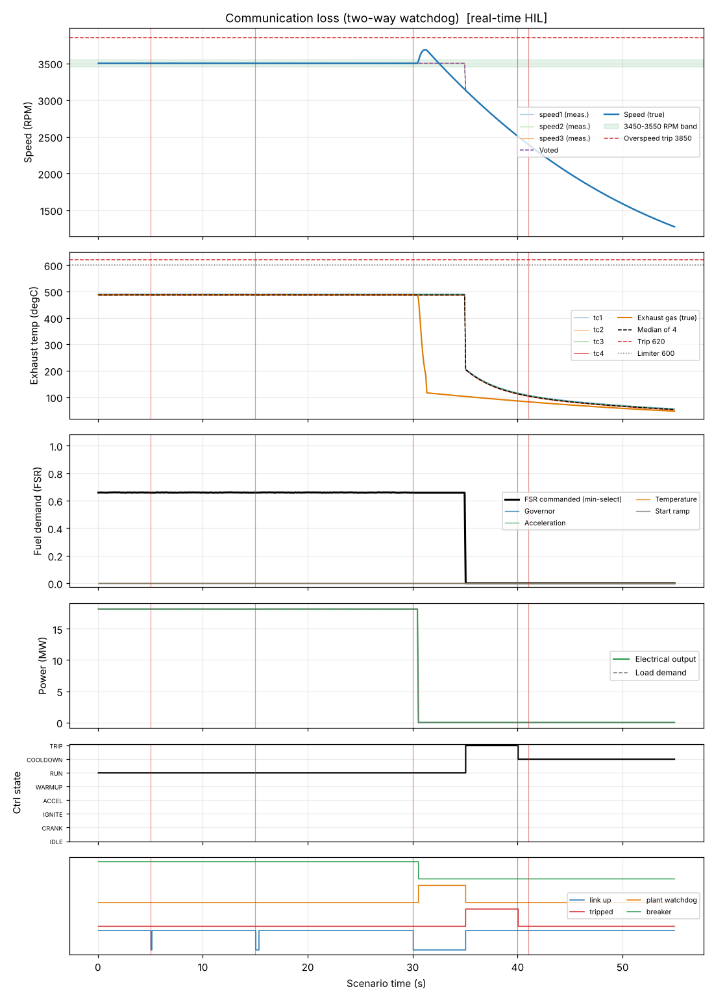

# Communication loss (two-way watchdog)

**Result: PASS**

Unit carries 80 % load. A 80 ms link dropout must pass unnoticed; a 300 ms dropout must raise an alarm only; a 5 s loss must trip the controller after 10 failed polls (500 ms) and make the plant side close the fuel valve and open the breaker by itself. The trip stays latched after the link returns and clears only on an explicit reset, after which the start request is locked out until it is re-issued.

## Criteria

| | Criterion | Measured | Limit |
| --- | --- | --- | --- |
| PASS | An 80 ms dropout raises no alarm | never set | never |
| PASS | Neither short dropout trips the unit | never set | never |
| PASS | The plant-side watchdog acts within 2 s of the loss | set at 30.6 s | between 30 and 32 s |
| PASS | The controller's trip is visible at the plant as soon as the link returns (by 38 s) | set at 35.0 s | between 30 and 38 s |
| PASS | Fuel flow is zero 2.5 s after the loss | 0.0 at 32.5 s | 0 to 0.01 |
| PASS | Breaker is open 2.5 s after the loss | 0.0 at 32.5 s | 0 to 0.5 |
| PASS | Speed stays below the overspeed trip level | peak 3684.0 | < 3850 |
| PASS | Trip is still latched 3 s after the link returned (no auto-reset) | 1.0 at 38.0 s | 0.5 to 1.5 |
| PASS | Explicit reset clears the trip | 0.0 at 45.0 s | -0.5 to 0.5 |
| PASS | With the start request still held, the unit does not restart (cool-down only) | 6.0 at 54.0 s | 5.5 to 6.5 |
| PASS | The first-out reported after the link returns is communication loss (code 10) | 10.0 at 38.0 s | 9.5 to 10.5 |

## Key figures

- Peak speed: 3684 RPM
- Final speed: 1274 RPM
- Peak exhaust gas temperature: 488 degC
- Peak fuel flow: 1.25 kg/s
- Peak electrical output: 18.2 MW
- Tripped: yes (first-out: none)
- Peak exhaust spread: 5 degC

## Events

- t = 5.0 s: link (up=False)
- t = 15.0 s: link (up=False)
- t = 30.0 s: link (up=False)
- t = 40.0 s: reset (value=1)
- t = 41.0 s: reset (value=0)

## Plot

## Run record

- mode: real-time HIL (software rehearsal: virtual serial, controller on Linux)
- scenario file: scenarios/communication_loss.json
- scenario sha256 (first 12): 778ef631ccb6
- run at (UTC): 2026-10-12 17:16:16
- seed: 61
- sensor noise: True
- rated electrical power (MW): 22.72
- python: 3.13.16
- host: Linux-6.18.44-fc-v114-x86_64-with-glibc2.39
- negative tests: not run in real time (see the software tier)
- criteria not checked in HIL: medium_alarm: the comms alarm lives only in the controller; it is visible on the STM32 serial log, not at the plant
- HIL note: On the real rig the plant only sees what the controller managed to write. During a link loss the controller cannot write, so its alarm and trip are invisible to the plant until the link returns (and the comms alarm has already cleared by then).
