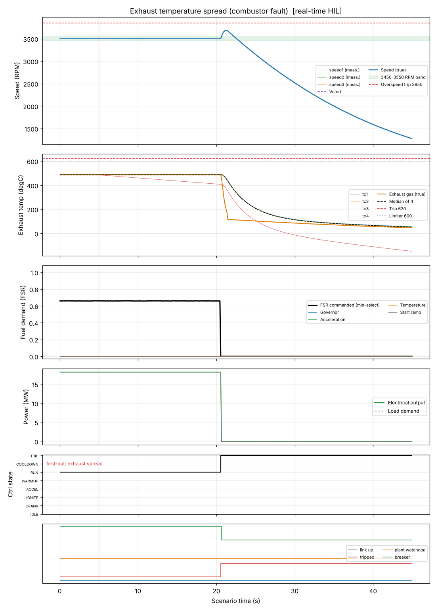

# Exhaust temperature spread (combustor fault)

**Result: PASS**

Unit carries 80 % load. Thermocouple 4 starts to read low at 5 degC/s, as it would behind a failed burner. The spread (max - min of the four) must raise an alarm at 40 degC and trip at 80 degC, with first-out recorded, while the median of four keeps the control temperature sane.

## Criteria

| | Criterion | Measured | Limit |
| --- | --- | --- | --- |
| PASS | Spread alarm is raised within 15 s | set at 12.0 s | between 5 and 20 s |
| PASS | No trip while the spread is below 80 degC | never set | never |
| PASS | Trip once the spread passes 80 degC (12 to 30 s) | set at 20.5 s | between 12 and 30 s |
| PASS | First-out cause is exhaust spread | exhaust spread | exh spread |
| PASS | Fuel flow is zero at the end | 0.0 at 44.0 s | 0 to 0.01 |
| PASS | True gas temperature stays below 620 degC throughout | peak 487.9 | < 620 |

## Key figures

- Peak speed: 3685 RPM
- Final speed: 1278 RPM
- Peak exhaust gas temperature: 488 degC
- Peak fuel flow: 1.25 kg/s
- Peak electrical output: 18.2 MW
- Tripped: yes (first-out: exhaust spread)
- Peak exhaust spread: 205 degC

## Events

- t = 5.0 s: tc_fault (ch=3, mode=drift, a=-5.0, b=200.0)

## Plot

## Run record

- mode: real-time HIL (software rehearsal: virtual serial, controller on Linux)
- scenario file: scenarios/exhaust_spread.json
- scenario sha256 (first 12): c12d101d9aa9
- run at (UTC): 2026-10-12 17:16:06
- seed: 41
- sensor noise: True
- rated electrical power (MW): 22.72
- python: 3.13.16
- host: Linux-6.18.44-fc-v114-x86_64-with-glibc2.39
- negative tests: not run in real time (see the software tier)
