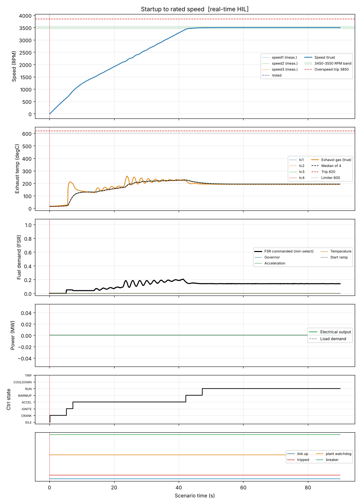

# Startup to rated speed

**Result: PASS**

Cold start from rest: crank, purge, light-off, accelerate, starter cut-out, governor takes over at rated speed (breaker open, no load).

## Criteria

| | Criterion | Measured | Limit |
| --- | --- | --- | --- |
| PASS | Speed reaches 3500 +/- 50 RPM within 60 s and holds for 10 s | reached at 42.7 s | <= 60 s |
| PASS | Speed never exceeds the 3850 RPM overspeed trip level | peak 3500.3 | < 3850 |
| PASS | Exhaust gas temperature stays below the 620 degC trip level | peak 256.7 | < 620 |
| PASS | Controller never trips | never set | never |

## Key figures

- Peak speed: 3500 RPM
- Final speed: 3500 RPM
- Peak exhaust gas temperature: 257 degC
- Peak fuel flow: 0.38 kg/s
- Peak electrical output: 0.0 MW
- Tripped: no
- Peak exhaust spread: 5 degC

## Events

- t = 0.0 s: start

## Plot

## Run record

- mode: real-time HIL (software rehearsal: virtual serial, controller on Linux)
- scenario file: scenarios/startup_to_rated.json
- scenario sha256 (first 12): b5bfdd8834a4
- run at (UTC): 2026-10-12 17:15:19
- seed: 7
- sensor noise: True
- rated electrical power (MW): 22.72
- python: 3.13.16
- host: Linux-6.18.44-fc-v114-x86_64-with-glibc2.39
- negative tests: not run in real time (see the software tier)
