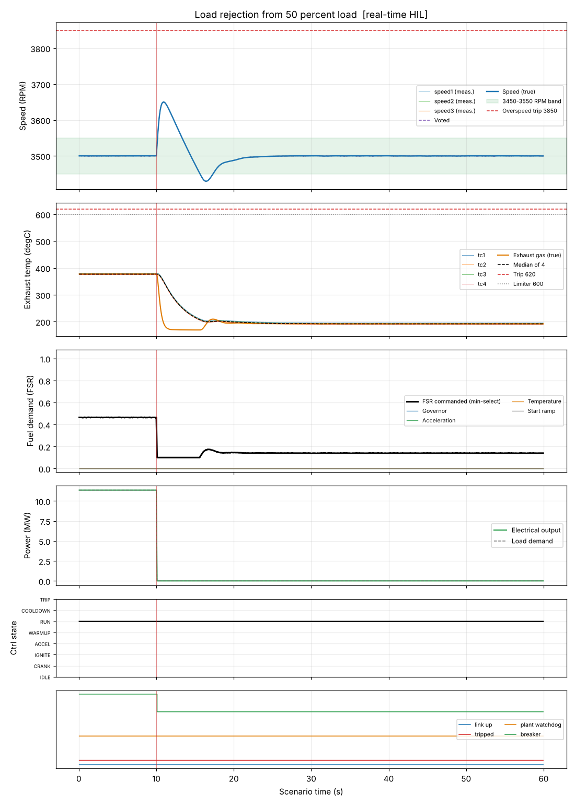

# Load rejection from 50 percent load

**Result: PASS**

Unit is started, brought to rated speed and loaded to 50 %. The generator breaker then opens and the whole load is lost at once. The governor must catch the speed surge.

## Criteria

| | Criterion | Measured | Limit |
| --- | --- | --- | --- |
| PASS | Speed is within 3450-3550 RPM just before the load is lost | 3500.1 at 9.5 s | 3450 to 3550 |
| PASS | Peak speed stays below the 3850 RPM overspeed trip level | peak 3650.1 | < 3850 |
| PASS | Speed returns to 3450-3550 RPM within 30 s of the load loss and holds for 10 s | settled 7.4 s after event | <= 30 s |
| PASS | Exhaust gas temperature stays below the 620 degC trip level | peak 377.9 | < 620 |
| PASS | Controller never trips | never set | never |

## Key figures

- Peak speed: 3650 RPM
- Final speed: 3500 RPM
- Peak exhaust gas temperature: 378 degC
- Peak fuel flow: 0.88 kg/s
- Peak electrical output: 11.4 MW
- Tripped: no
- Peak exhaust spread: 5 degC

## Events

- t = 10.0 s: open_breaker

## Plot

## Run record

- mode: real-time HIL (software rehearsal: virtual serial, controller on Linux)
- scenario file: scenarios/load_rejection.json
- scenario sha256 (first 12): 2c71792718e9
- run at (UTC): 2026-10-12 17:20:34
- seed: 11
- sensor noise: True
- rated electrical power (MW): 22.72
- python: 3.13.16
- host: Linux-6.18.44-fc-v114-x86_64-with-glibc2.39
- negative tests: not run in real time (see the software tier)
